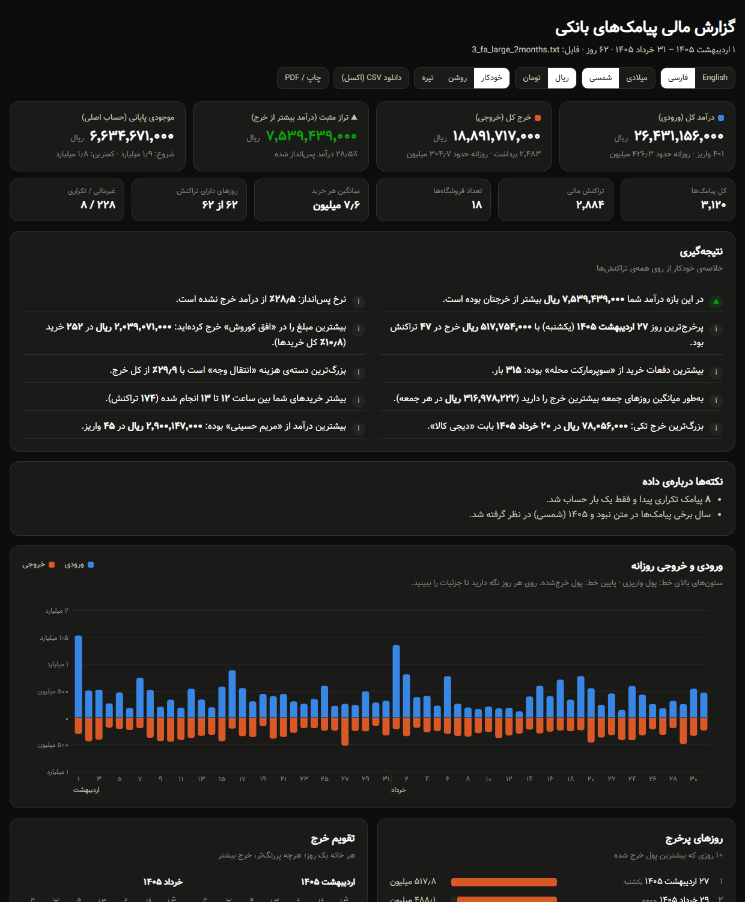

<div dir="rtl">

# تحلیلگر پیامک‌های بانکی

**پیامک‌های بانکی کپی‌شده در یک فایل متنی را به یک گزارش تعاملی و دوزبانه (فارسی / انگلیسی) از درآمد و خرج تبدیل می‌کند.**

همه‌ی پیامک‌های بانک را در یک فایل `txt` بریزید، یک دستور اجرا کنید و گزارش HTML را باز کنید:
درآمد و خرج کل، تراز، اینکه پول کجا خرج شده، پرخرج‌ترین روزها، خرج به تفکیک دسته و روز هفته و ساعت،
روند موجودی و جدول قابل جستجوی همه‌ی تراکنش‌ها.

[English → README.md](README.md)



## امکانات

- **هر زبان و هر بانکی:** قالب پیامک بانک خودتان را یک بار در فایل [`sms_formats.txt`](sms_formats.txt) با جای خالی‌هایی مثل `{amount}` و `{date:d/m/yyyy}` بنویسید. پیامک‌هایی که برچسب دارند (`مبلغ: …`، `Amount: …`، `Kontostand: …`) حتی بدون قالب هم خوانده می‌شوند.
- **داده‌ی نامرتب مشکلی ندارد:** پیامک‌های نامرتب، بدون خط خالی یا با چند خط خالی، خط خالی وسط یک پیامک، اعداد فارسی، علائم نامرئی راست‌به‌چپ، پیامک تکراری، پیامک یک‌خطی.
- **رمز پویا، کد تایید و تبلیغ** تراکنش حساب نمی‌شوند و جداگانه در گزارش نمایش داده می‌شوند.
- **همه‌ی شکل‌های عدد و تاریخ:** `400,000`، `1.234,56`، تومان/ریال، `1405/02/22`، `22/2/1405`، `05/02/22`، `22 اردیبهشت 1405` و تاریخ میلادی.
- **تقویم شمسی و میلادی** هم در خواندن و هم در گزارش.
- **کنترل با موجودی:** تراکنش‌ها بر اساس تاریخ مرتب و موجودی هر حساب پشت سر هم چک می‌شود؛ اگر پیامکی جا افتاده باشد هشدار می‌دهد. اگر پیامک علامت یا نوع نداشته باشد، واریز یا برداشت بودن از روی موجودی حدس زده می‌شود.
- **گزارش دوزبانه:** تغییر فارسی/انگلیسی، شمسی/میلادی، ریال/تومان، روشن/تیره. یک فایل HTML بدون نیاز به اینترنت. خروجی CSV برای اکسل و چاپ PDF.
- **بدون هیچ کتابخانه‌ی جانبی:** فقط پایتون.

## اجرا

```bash
python generate_samples.py
python analyze.py samples/3_fa_large_2months.txt
```

برای پیامک‌های خودتان آن‌ها را از گوشی در یک فایل متنی کپی کنید و اجرا کنید:

```bash
python analyze.py my_sms.txt
```

اگر اسم فایل را ندهید پنجره‌ی انتخاب فایل باز می‌شود. روی ویندوز می‌توانید فایل را روی `analyze.py` بکشید و رها کنید.
گزینه‌های بیشتر: `python analyze.py --help`

## تعریف قالب بانک خودتان

یک پیامک واقعی را زیر یک عنوان جدید در `sms_formats.txt` بگذارید و قسمت‌های متغیر را با جای خالی عوض کنید:

<div dir="ltr">

```text
[template: بانک من]
@language: fa
{bank}
{type} {amount} ریال
مانده {balance}
{date:yy/mm/dd} {time}
```

</div>

| جای خالی | معنی |
|---|---|
| `{amount}` `{balance}` `{fee}` | مبلغ، موجودی، کارمزد |
| `{type}` | کلمه‌ای مثل برداشت / واریز / خرید (واریز یا برداشت بودن را مشخص می‌کند) |
| `{merchant}` `{person}` `{desc}` `{bank}` | فروشگاه، شخص، شرح، نام بانک |
| `{account}` `{tracking}` `{ref}` | حساب/کارت و شماره‌ی پیگیری |
| `{date}` یا `{date:d/m/yyyy}` | تاریخ (با قالب دلخواه) |
| `{time}` | ساعت |
| `[[ … ]]` | بخش اختیاری |

توضیح کامل همه‌ی گزینه‌ها و چند نمونه‌ی آماده (فارسی، انگلیسی، آلمانی، اسپانیایی، هندی، ترکی) بالای همان فایل نوشته شده است.

## تست

```bash
python -m unittest discover -s tests -v
```

## حریم خصوصی

همه‌ی پردازش روی رایانه‌ی خودتان انجام می‌شود و گزارش هیچ چیزی از اینترنت بارگذاری نمی‌کند.
پیامک‌های واقعی خودتان را در گیت‌هاب نگذارید؛ پوشه‌ی `private/` و فایل‌های `*_report.html` در `.gitignore` هستند.

</div>
