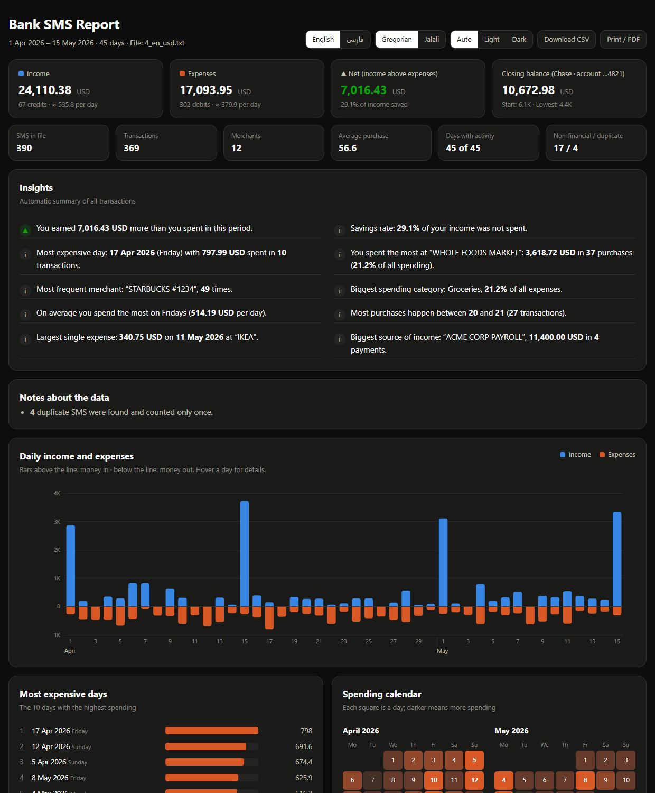

# Bank SMS Analyzer

**Turn a text file of copied bank SMS into an interactive, bilingual (English / فارسی) report of your income and expenses.**

Paste all your bank's text messages into a `.txt` file, run one command and open the HTML report:
total income and spending, net balance, where the money went, the most expensive days, spending by
category, weekday and hour, balance over time, and a searchable table of every transaction.

[فارسی ← README.fa.md](README.fa.md)

| English · Gregorian | فارسی · شمسی |
|---|---|
|  |  |

## Features

- **Any language, any bank.** Describe your bank's SMS once in [`sms_formats.txt`](sms_formats.txt) using
  placeholders like `{amount}` and `{date:dd.mm.yyyy}`. Labelled messages (`Amount: …`, `مبلغ: …`,
  `Kontostand: …`) are understood even without a template.
- **Messy input is fine:** unsorted messages, missing or extra blank lines, a blank line inside one SMS,
  Persian/Arabic digits, invisible right-to-left marks, duplicates, one-line SMS.
- **Not every SMS is a transaction:** OTP / verification codes and ads are set aside (and listed in the report).
- **Numbers and dates the way banks write them:** `1,234.56`, `1.234,56`, `400,000`, `12,50 €`, `$1,234`, toman/rial;
  `21.04.2026`, `04/21/2026`, `1405/02/22`, `05/02/22`, `6 Apr 26`, `22 اردیبهشت 1405`, `2:05 PM`.
- **Jalali and Gregorian calendars**, both in the parser and in the report.
- **Checked against the balance:** transactions are sorted and the running balance of every account is verified,
  so a missing SMS shows up as a warning. When the SMS has no sign or type word, the direction is inferred from the balance.
- **Bilingual report:** switch English / Persian (LTR / RTL), Jalali / Gregorian, rial / toman, light / dark.
  Single HTML file, no internet needed, nothing is uploaded anywhere. CSV export and print-to-PDF included.
- **Zero dependencies:** standard-library Python only.

## Quick start

```bash
# requires Python 3.9+, nothing to install
git clone https://github.com/<you>/bank-sms-analyzer.git
cd bank-sms-analyzer
python generate_samples.py                 # optional: create sample files in ./samples
python analyze.py samples/4_en_usd.txt     # report opens in your browser
```

Use your own SMS by copying them from your phone into a text file (one after another; blank lines between them help
but are not required) and running:

```bash
python analyze.py my_sms.txt
```

Running `python analyze.py` without a file opens a file picker. On Windows you can also drag a `.txt` file onto `analyze.py`.

| Option | Meaning |
|---|---|
| `-o report.html` | output path (default: `<input>_report.html`) |
| `-f formats.txt` | templates file (default: `./sms_formats.txt`) · `--no-formats` to skip it |
| `--lang en\|fa` | initial report language (default: Persian for Persian SMS, otherwise English) |
| `--calendar jalali\|gregorian` | calendar for two-digit years and the initial report calendar |
| `--date-order dmy\|mdy\|ymd` | order of ambiguous numeric dates like `05/04/26` |
| `--decimal ,` | decimal separator of the amounts when it is ambiguous |
| `--currency EUR` | currency to assume when the SMS don't mention one |
| `--json data.json` | also save the analysis as JSON |
| `--no-open` | don't open the browser |

Several files can be analysed together: `python analyze.py bank1.txt bank2.txt`.

## Teaching it your bank's format

Open [`sms_formats.txt`](sms_formats.txt), paste one real message under a new header and replace the
changing parts with placeholders:

```text
[template: My bank]
@currency: EUR
@decimal: ,
{bank}: {type} {amount} [[bei {merchant}]] [[an {person}]] am {date:dd.mm.yyyy} um {time}. Kontostand: {balance}
```

| Placeholder | Meaning |
|---|---|
| `{amount}` `{balance}` `{available}` `{fee}` | amounts (sign and currency symbol/code allowed) |
| `{type}` | a word such as *debited*, *Gutschrift*, *برداشت* - decides income vs. expense |
| `{merchant}` `{person}` `{desc}` `{bank}` | names and descriptions |
| `{account}` `{ref}` `{tracking}` `{currency}` | identifiers |
| `{date}` / `{date:dd.mm.yyyy}` / `{date:d mmm yyyy}` / `{date:yy/mm/dd}` | date, optionally with its format |
| `{time}` | `14:32`, `2:32 PM`, `14.32`, `14h32` |
| `{skip}` / `{*}` | ignore text (one line / anything) |
| `[[ … ]]` | optional part |

Spaces, line breaks and letter case are flexible. Options such as `@direction: out`, `@calendar: jalali`,
`@date-order: mdy` or extra `@in:` / `@out:` words are documented at the top of the file, together with
ready-made examples (US, German, Persian, Spanish, Indian, Turkish). The `[keywords]` section adds words that
mean money in or out, in any language.

## How it works

```text
txt file ──► normalise text (digits, Arabic letters, RTL marks)
         ──► 1. templates from sms_formats.txt (regex built from each example)
         ──► 2. built-in label reader for everything else (multilingual labels and type words)
         ──► transactions: drop OTP/ads/duplicates, fill missing years, sort by date,
             verify the balance chain per account, categorise merchants
         ──► statistics + insights (language-neutral JSON)
         ──► single-file HTML report (renders in English or Persian)
```

```text
analyze.py              command line entry point
generate_samples.py     sample SMS files with known correct answers
sms_formats.txt         your SMS templates (edit this)
sms_analyzer/
  templates.py          templates file parser and matcher
  heuristic.py          built-in label reader
  keywords.py           multilingual labels, type words, OTP words
  parser.py             pipeline: records -> transactions, duplicates, sorting, balance check
  numbers.py, dates.py  amount/currency and date/time parsing
  jalali.py             Jalali <-> Gregorian conversion
  categories.py         automatic categories (edit to add merchants)
  analysis.py           statistics and insights
  report.py, report_template.html   the HTML report
tests/                  unit tests + checks against the sample files
```

## Sample files

`python generate_samples.py` writes five files with their correct answers (`*.expected.json`):

| File | Content |
|---|---|
| `1_fa_simple.txt` | 10 Persian SMS in one format |
| `2_fa_messy.txt` | 6 Iranian bank formats: unsorted, Persian digits, missing blank lines, duplicates, OTP, ads, toman, one-line SMS |
| `3_fa_large_2months.txt` | ~50 SMS a day for two months (3,100+ SMS), newest first and shuffled |
| `4_en_usd.txt` | US-style alerts (templates) mixed with labelled multi-line SMS, amounts with cents |
| `5_de_eur.txt` | German push messages (templates) mixed with labelled SMS, `1.234,56 EUR` style |

## Tests

```bash
python -m unittest discover -s tests -v
```

The tests check the number/date parsers, the label reader, templates and error messages, the HTML report,
the command line and - for every sample file - that totals, counts, duplicates, top merchant, top day and
merchant names exactly match the known answers and that the balance chain has no breaks.

## Privacy

Everything runs locally. The report is a single HTML file with the data embedded; it loads nothing from the
internet. Don't commit your own SMS files - `.gitignore` already excludes `*_report.html` and a `private/` folder.

## License

[MIT](LICENSE)
